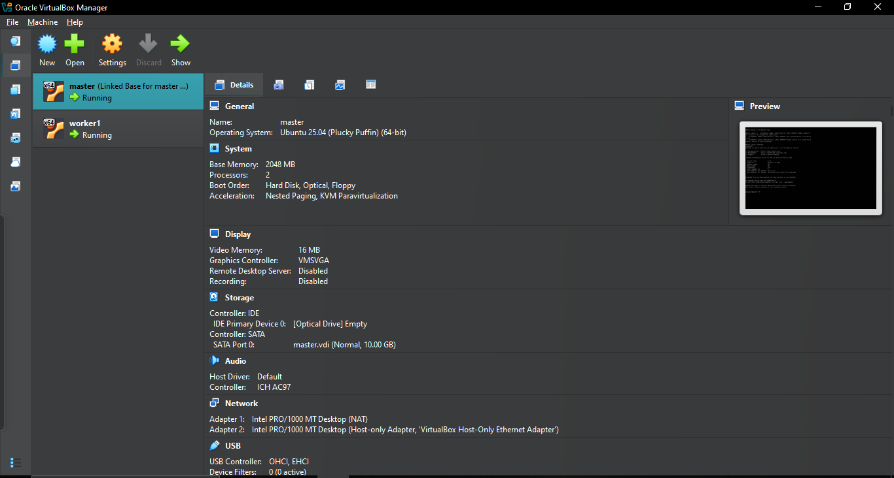
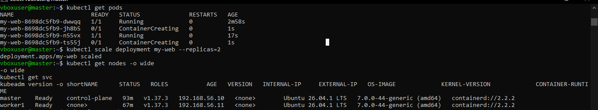
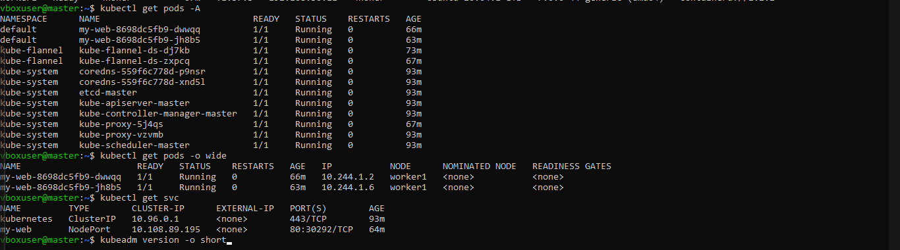
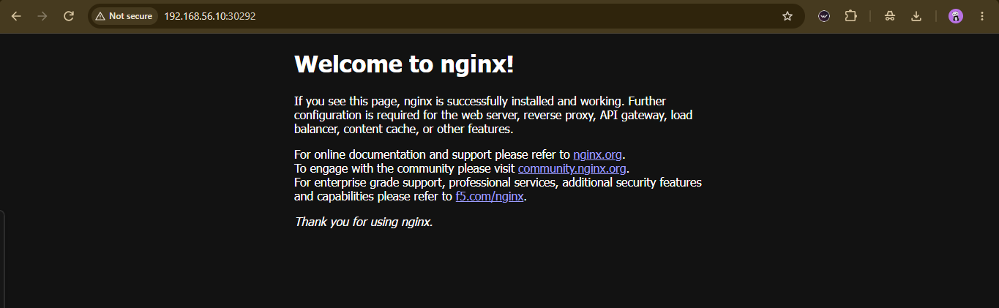

# Kubernetes 2-Node Cluster Lab (VirtualBox + kubeadm)

A hands-on lab where I built a real Kubernetes cluster from scratch on my own laptop using VirtualBox, Ubuntu Server and `kubeadm`, then deployed a web app on it and tested self-healing and scaling.

This is a **learning lab**, not a production setup.

## What I built

| Item | Value |
|---|---|
| Nodes | 1 control plane (`master`) + 1 worker (`worker1`) |
| OS | Ubuntu Server 26.04.1 LTS |
| Kubernetes | v1.37.3 (installed with `kubeadm`) |
| Container runtime | containerd 2.2.2 |
| Network plugin (CNI) | Flannel |
| Virtualization | Oracle VirtualBox |
| Each VM | 2 vCPU, 2 GB RAM, 10 GB disk |

## Architecture

```
Windows laptop (8 GB RAM)
 |
 +-- VirtualBox Host-only network 192.168.56.0/24
      |
      +-- master  (192.168.56.10)  control plane: API server, etcd, scheduler, controller manager
      |
      +-- worker1 (192.168.56.11)  runs the app pods

Each VM also has a NAT adapter for internet access.
Pod network: 10.244.0.0/16 (Flannel)
```

## Why two network adapters?

VirtualBox NAT gives every VM the same IP (`10.0.2.15`), which breaks a Kubernetes cluster. So each VM has:

- **Adapter 1 (NAT):** internet access only
- **Adapter 2 (Host-only):** fixed IP used by the cluster and by my laptop

## Steps I followed (summary)

1. **Create the VM** in VirtualBox and install Ubuntu Server. Add a Host-only adapter and set a fixed IP with netplan.
2. **Connect over SSH** from Windows PowerShell, so I can copy and paste commands.
3. **Prepare the node** (on every machine):
   ```bash
   sudo swapoff -a && sudo sed -i '/ swap / s/^/#/' /etc/fstab
   sudo modprobe overlay && sudo modprobe br_netfilter
   # enable ip_forward and bridge-nf-call settings with sysctl
   sudo apt install -y containerd
   # set SystemdCgroup = true in /etc/containerd/config.toml
   sudo apt install -y kubelet kubeadm kubectl
   sudo apt-mark hold kubelet kubeadm kubectl
   echo 'KUBELET_EXTRA_ARGS=--node-ip=<HOST_ONLY_IP>' | sudo tee /etc/default/kubelet
   ```
4. **Clone the master** (VirtualBox linked clone) to create `worker1`, then give the clone its own hostname, machine-id and IP.
5. **Initialize the control plane** (on master):
   ```bash
   sudo kubeadm init --apiserver-advertise-address=192.168.56.10 --pod-network-cidr=10.244.0.0/16
   mkdir -p $HOME/.kube && sudo cp /etc/kubernetes/admin.conf $HOME/.kube/config
   sudo chown $(id -u):$(id -g) $HOME/.kube/config
   ```
6. **Install the network plugin** (Flannel), forcing it to use the host-only interface with `--iface=enp0s8`.
7. **Join the worker** (on worker1):
   ```bash
   sudo kubeadm join 192.168.56.10:6443 --token <TOKEN> --discovery-token-ca-cert-hash sha256:<HASH>
   ```
8. **Deploy an app** (on master):
   ```bash
   kubectl create deployment my-web --image=nginx --replicas=2
   kubectl expose deployment my-web --type=NodePort --port=80
   ```

## Results

Both nodes are `Ready`, all system pods are `Running`, and the nginx app opens in the browser from my laptop.

| | Screenshot |
|---|---|
| Both VMs running in VirtualBox |  |
| Nodes Ready |  |
| Pods and services |  |
| App in the browser (NodePort 30292) |  |

### Tests I ran

- **Self-healing:** deleted one pod with `kubectl delete pod ...` and Kubernetes created a new one within a second.
- **Scaling:** scaled the deployment from 2 to 4 replicas with one command, then back to 2 (`kubectl scale deployment my-web --replicas=4`).
- **Access from outside the cluster:** a NodePort service made the app reachable on `http://192.168.56.10:30292`.

## Problems I ran into and how I fixed them

| Problem | Fix |
|---|---|
| Could not log in to the VM (unattended install, unknown password) | Booted into GRUB, added `init=/bin/bash` to the kernel line, and reset the password with `passwd` |
| Could not paste into the VirtualBox window | Installed OpenSSH server and connected from PowerShell with `ssh` |
| `kubeadm init` failed: RAM 1642 MB is less than the minimum 1700 MB | Re-ran with `--ignore-preflight-errors=Mem` (fine for a lab) |
| Both VMs have the same NAT IP (`10.0.2.15`) | Added a Host-only adapter with fixed IPs and set `--node-ip` for kubelet |
| Flannel could pick the wrong network interface | Added `--iface=enp0s8` to the Flannel DaemonSet arguments |
| Cloned VM looked identical to the master | Changed hostname, regenerated machine-id, set a new IP, and used new MAC addresses |

## What I learned

- What the control plane, worker nodes, kubelet, containerd and CNI each do
- How `kubeadm init` and `kubeadm join` build a cluster
- Why swap must be off and why `SystemdCgroup = true` matters
- Pods, Deployments and Services (NodePort), plus self-healing and scaling
- How to debug networking issues in a multi-VM lab

## Limitations

- One control plane node (no high availability)
- Tiny resources (2 GB RAM per node), so I ignored one RAM pre-flight check
- No Ingress, persistent storage, monitoring or security hardening

## Next steps

- Deploy the app from YAML files instead of imperative commands
- Try Ingress and rolling updates
- Add monitoring (Prometheus and Grafana)
- Practice on a managed cluster (EKS, AKS or GKE)
